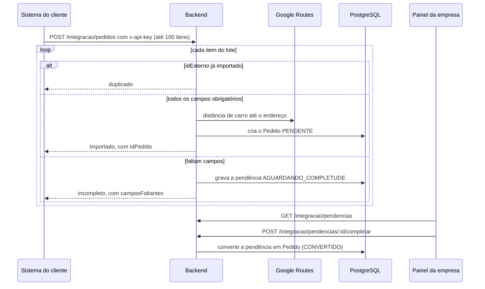

# Integração e segurança

## Integração com o sistema de gestão do cliente (E-US12)

O estabelecimento pode importar pedidos do próprio sistema de gestão, sem
recadastrar nada no painel. A integração é uma API REST autenticada por uma
credencial da empresa.

### Credencial

| Método | Rota | O que faz |
|---|---|---|
| GET | `/integracao/credencial` | mostra se existe credencial ativa e o prefixo dela |
| POST | `/integracao/credencial` | cria a credencial; a chave completa aparece só nesta resposta |
| POST | `/integracao/credencial/rotacionar` | troca a chave; a anterior deixa de valer na hora |
| DELETE | `/integracao/credencial` | revoga a credencial |
| GET | `/integracao/verificar` | o sistema do cliente testa a chave |

- A chave tem o formato `vv_<prefixo>_<segredo>`, com 32 bytes aleatórios no
  segredo.
- O banco guarda só o SHA-256 da chave. A comparação usa `timingSafeEqual`.
- O sistema do cliente envia a chave no cabeçalho `x-api-key`. As rotas de
  credencial exigem login de estabelecimento; `verificar` e a importação
  exigem só a chave.

### Importação de pedidos

- A resposta traz um resumo e o resultado de cada item. Um item com erro não
  derruba o lote.
- O `idExterno` é único por empresa, então reenviar o mesmo lote não duplica
  pedidos.
- Se o Google falhar ou não houver chave configurada, o pedido entra com a
  distância marcada como desconhecida. A empresa informa a distância em
  `PATCH /pedidos/:id/distancia` antes da finalização, que exige distância
  conhecida para consolidar o ganho (E-US16).

## WhatsApp

Histórias E-US19, E-US20 e EN-US07. A plataforma não envia nem recebe mensagens. A API devolve um link `wa.me` com
o telefone da outra parte e uma mensagem inicial que cita o pedido. A conversa
acontece no WhatsApp de cada um.

| Quem abre | Rota | Disponível quando |
|---|---|---|
| Empresa, com o entregador | `GET /pedidos/:id/whatsapp/entregador` | pedido `EM_ANDAMENTO` |
| Entregador, com a empresa | `GET /pedidos/:id/whatsapp/estabelecimento` | pedido `EM_ANDAMENTO` e atribuído a ele |
| Empresa, com o recebedor | `GET /pedidos/:id/whatsapp/recebedor` | pedido `PENDENTE` ou `EM_ANDAMENTO` |
| Recebedor, com a empresa | campo `whatsappEstabelecimento` de `GET /rastreio/:token` | entrega aberta |

- Fora da janela, a rota responde 409. Telefone que não vira número
  internacional válido responde 422.
- Recebedor e entregador nunca recebem o telefone um do outro.

### Diferença em relação ao backlog

O backlog previa a WhatsApp Business Platform (Cloud API da Meta), com webhook,
histórico de mensagens e modelos aprovados. A implementação usa links `wa.me`,
que não dependem de conta Meta Business nem de aprovação de modelos (o risco
"Verificação Meta atrasar" do cronograma) e não guardam mensagens na
plataforma. Ficaram de fora: histórico no painel, indicação de mensagens não
lidas e notificação automática na atribuição.

## Acesso do recebedor sem conta (R-US01)

1. A empresa gera o link em `POST /pedidos/:id/link-rastreio`. A resposta traz o
   link e o código de 6 dígitos do recebedor, e é a única vez que o link
   aparece.
2. O token do link tem 32 bytes aleatórios (base64url, 43 caracteres). O banco
   guarda só o SHA-256 dele.
3. Gerar um link novo invalida o anterior; quem estiver com a página aberta
   recebe `acesso-negado` no Socket.IO.
4. Com a entrega encerrada, o link deixa de mostrar o rastreio, mas continua
   valendo para a avaliação (R-US05 e R-US06) por 7 dias.

### Código do recebedor (EN-US06)

O entregador só finaliza a entrega com o código que o recebedor vê na página de
rastreio. Depois de 5 códigos errados, a finalização fica bloqueada por 15
minutos.

## Autenticação e sessão

- Login separado por persona: e-mail para a empresa, CPF para o entregador.
- Senhas com bcrypt (custo 12), entre 8 e 72 caracteres ASCII imprimíveis, para
  que o bcrypt nunca corte a senha. Login com usuário inexistente também calcula
  um hash, para que o tempo de resposta não revele quem tem conta.
- O JWT vai num cookie `vemvindo_token` `httpOnly`, `secure` em produção e
  `SameSite=Lax` (ou `None` quando front e back ficam em domínios diferentes,
  pela variável `COOKIE_SAMESITE`). O header `Authorization: Bearer` continua
  aceito para clientes de API.
- Cada usuário tem uma versão de sessão no banco, conferida a cada requisição.
  Trocar a senha ou chamar `POST /auth/sair-de-todos` invalida os tokens
  emitidos antes.
- A senha temporária do entregador vale 48 horas. Enquanto ela estiver ativa,
  só as rotas de primeiro acesso respondem; as outras devolvem 403.

## Diretrizes de segurança aplicadas

| Diretriz | Como está implementada |
|---|---|
| Isolamento por tenant | `empresaId` vem do token, nunca do corpo; toda consulta da empresa filtra por ele; pedido de outra empresa responde 404 |
| Dados do entregador (LGPD) | a empresa só vê nome, CPF, telefone, veículo, placa e disponibilidade, e só com vínculo `ATIVO` |
| Limite de tentativas | 100 requisições por minuto por IP no geral; 5 por minuto em login, cadastro e troca de senha; 10 por minuto em cadastro e convite de entregador e no envio de avaliação |
| Convite sem enumeração | `POST /entregadores/vinculo` responde 202 com a mesma mensagem para qualquer CPF |
| Entrada validada | `ValidationPipe` com `whitelist` e `forbidNonWhitelisted`; CPF, CNPJ, CEP e placa com validadores próprios |
| Cabeçalhos | `helmet()` no backend; `Cache-Control: no-store` em todas as respostas |
| Segredos | nenhum segredo versionado; validação do ambiente no boot; em produção, front obrigatoriamente em HTTPS |
| Dependências e imagem | `npm audit`, dependency review, CodeQL e Trivy no CI (ver [Pipeline de CI/CD](../qualidade/pipeline-ci-cd.md)) |
| Logs | endereços e coordenadas não vão para o log nas chamadas ao Google |
