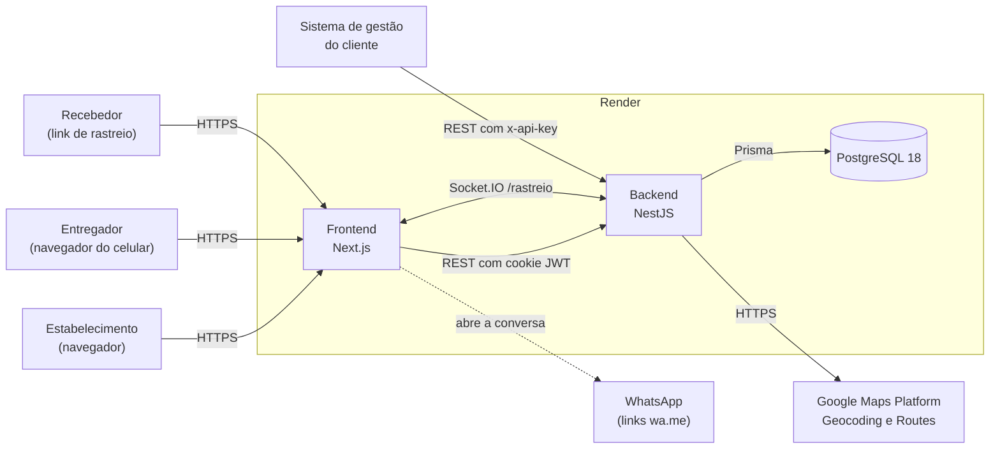
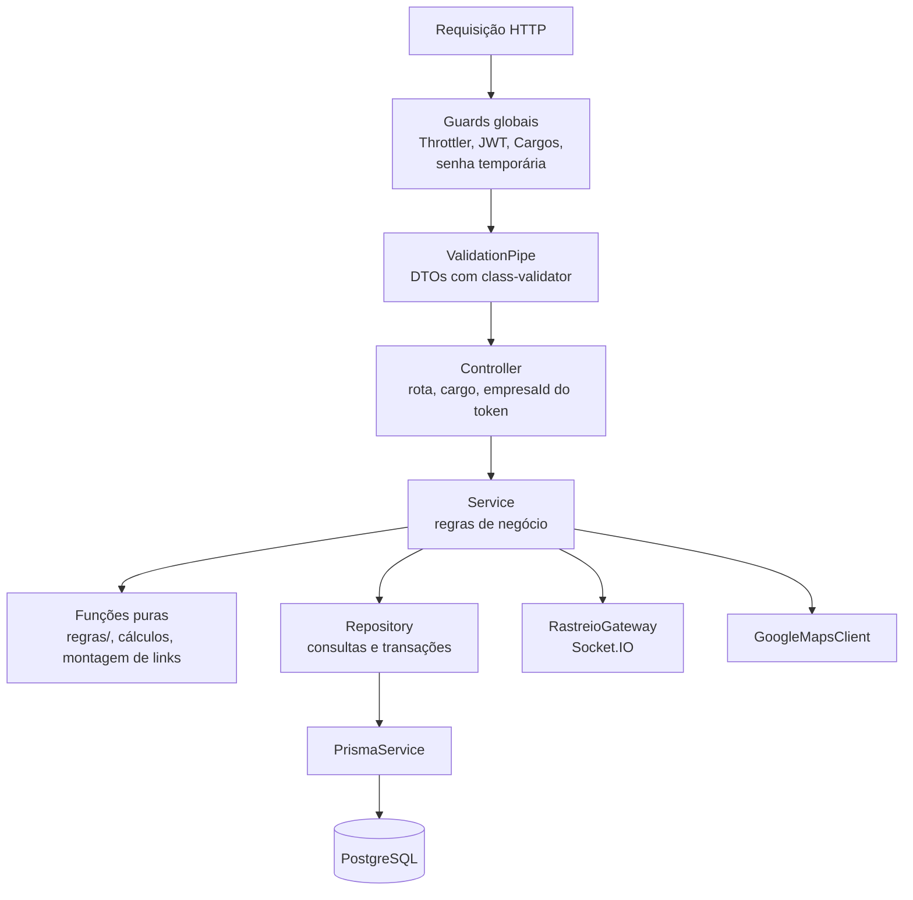
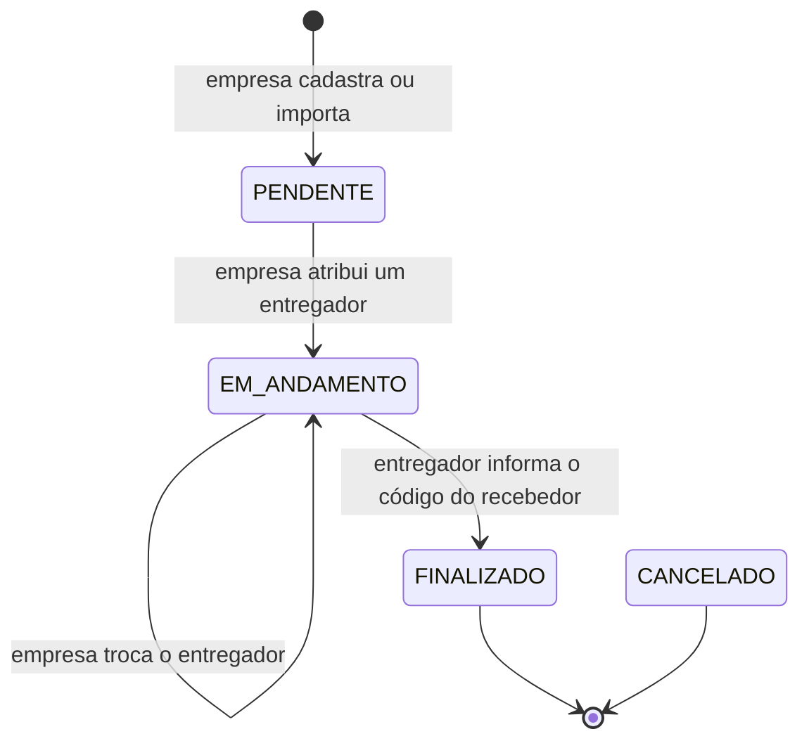
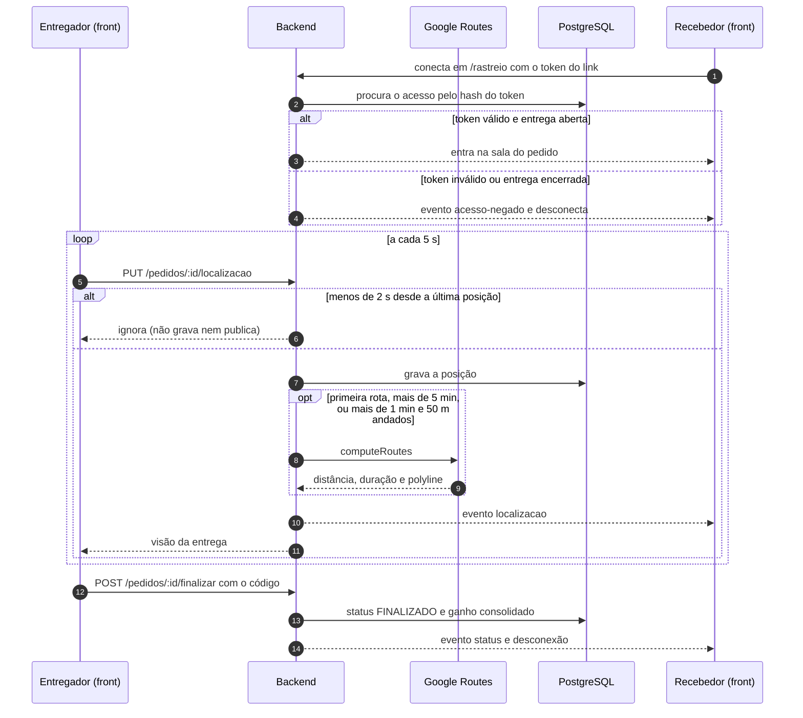
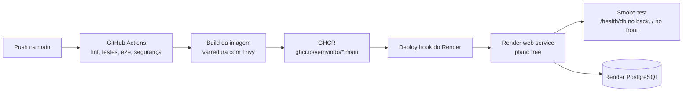

# Visão arquitetural

O VemVindo é uma aplicação web multitenant dividida em três repositórios da
organização [VemVindo](https://github.com/VemVindo):

| Repositório | Papel |
|---|---|
| `frontend` | Interfaces do estabelecimento, do entregador e do recebedor |
| `backend` | API REST, regras de negócio, persistência e canal em tempo real |
| `docs` | Esta documentação (Docusaurus, publicada no GitHub Pages) |

## Stack

| Camada | Tecnologia | Versão |
|---|---|---|
| Frontend | Next.js (App Router) com React | Next 16.4, React 19.3 |
| Estilo | Tailwind CSS | 4.3 |
| Mapa no navegador | `@vis.gl/react-google-maps` (Maps JavaScript API) | 1.10 |
| Tempo real no navegador | `socket.io-client` | 4.8 |
| Backend | NestJS | 11 |
| ORM | Prisma com driver adapter `@prisma/adapter-pg` | 7 |
| Banco | PostgreSQL | 18 |
| Autenticação | JWT (`@nestjs/jwt`, `passport-jwt`) e bcrypt | |
| Tempo real no servidor | Socket.IO (`@nestjs/websockets`) | |
| Rotas e geocodificação | Google Geocoding API e Routes API | |
| Runtime | Node.js | 24 |
| Testes | Jest e Supertest (backend), Vitest e Testing Library (frontend) | |

## Visão de containers

O diagrama mostra quem fala com quem em produção. O recebedor não tem conta: ele
entra pelo link de rastreio, que carrega um token.

Pontos que o diagrama não mostra:

- O navegador chama a API direto (CORS com `credentials: true`), sem proxy no
  Next. A URL da API entra no build do front pela variável
  `NEXT_PUBLIC_API_URL`.
- O WhatsApp não é chamado pelo backend. A API só monta o link `wa.me` com o
  telefone e uma mensagem inicial; quem abre a conversa é o navegador.
- Sem `GOOGLE_MAPS_SERVER_KEY`, a API não chama o Google: distância e tempo
  passam a ser estimados em linha reta.

## Modelo multitenant

Todos os estabelecimentos usam a mesma instância e o mesmo banco. O isolamento é
feito pela aplicação:

- o JWT do estabelecimento carrega o `empresaId`, e os controllers o repassam ao
  service, que filtra toda consulta por ele;
- o entregador não pertence a uma empresa só. Ele acessa os pedidos atribuídos
  ao próprio CPF e enxerga as empresas com quem tem vínculo `ATIVO`;
- a empresa só recebe dados pessoais de um entregador enquanto o vínculo está
  `ATIVO`. O que ela vê fica definido num único lugar
  (`src/entregador/dados-visiveis-empresa.ts`);
- o recebedor só alcança o pedido do próprio link, pelo hash do token.

Pedido de outra empresa responde 404, e não 403, para não revelar que o id
existe.

## Camadas do backend

Cada módulo segue a mesma divisão: o controller recebe e valida a requisição, o
service guarda a regra de negócio e o repository é o único que fala com o
Prisma.

Regras que valem para todos os módulos:

- toda rota é protegida por padrão; as públicas usam `@Public()` e as restritas
  a um perfil usam `@Cargos(...)`;
- o `ValidationPipe` global roda com `whitelist` e `forbidNonWhitelisted`:
  campo fora do DTO derruba a requisição com 400;
- regras sem dependência (transições de status, cálculo do valor da entrega,
  link do WhatsApp, linha do tempo) ficam em funções puras, testadas sem mock;
- a única exceção à divisão em camadas é o `HealthController`, que roda um
  `SELECT 1` direto no Prisma.

### Módulos

| Módulo | Responsabilidade | Histórias |
|---|---|---|
| `auth` | Cadastro da empresa, login das duas personas, troca de senha, sessão | E-US01, EN-US01 |
| `empresa` | Cadastro editável e configurações (exibir mapa ao recebedor) | E-US02, E-US03 |
| `entregador` | Frota: cadastro, convite, edição, nova senha temporária, desvínculo | E-US04, E-US05, E-US06, E-US21 |
| `vinculo` | Lado do entregador: convites, aceite, recusa e saída da frota | E-US04 |
| `pedido` | Cadastro, listas, atribuição, reatribuição, status, finalização com código, links do WhatsApp | E-US07 a E-US11, E-US13, E-US19, E-US20, EN-US03, EN-US04, EN-US06, EN-US07 |
| `integracao` | Credencial de API por empresa, importação de pedidos e pendências | E-US12 |
| `mapa` | Posição do entregador, rota de carro, geocodificação, adaptador Socket.IO | EN-US02, R-US03, R-US04 |
| `rastreio` | Link do recebedor, código de confirmação, linha do tempo, gateway em tempo real | R-US01 a R-US04 |
| `avaliacao` | Nota e comentário do recebedor; lista da empresa | R-US05, R-US06, E-US17 |
| `remuneracao` | Parâmetros de remuneração e consolidação do ganho por entrega | E-US15, E-US16 |
| `prisma`, `common`, `config`, `health` | Acesso ao banco, guards, interceptors, validação do ambiente, healthcheck | |

A lista de rotas fica em [Referência da API](./referencia-da-api.md).

## Ciclo de vida do pedido

- As transições ficam numa tabela única (`src/pedido/regras/status-pedido.regra.ts`).
- `FINALIZADO` só é alcançado por `POST /pedidos/:id/finalizar`, com o código de
  6 dígitos que o recebedor vê na página de rastreio. Por isso a rota
  `GET /pedidos/:id/status-disponiveis` nunca oferece `FINALIZADO`.
- `CANCELADO` existe no enum, mas a API ainda não tem rota que leve a ele.
- Com a entrega encerrada, a posição do entregador é apagada e a sala do
  recebedor no Socket.IO é fechada.
- Na atribuição, os parâmetros de remuneração vigentes são copiados para o
  pedido. Na finalização, o ganho é calculado com esses valores congelados
  (`taxa fixa + coeficiente × km`, em centavos, arredondado) e gravado em
  `ganho_consolidado_centavos`.

## Rastreio em tempo real

O entregador envia a posição por HTTP e o recebedor só escuta pelo Socket.IO.
O gateway não tem `@SubscribeMessage`: nenhum evento vindo do cliente é
processado.

Eventos do namespace `/rastreio`:

| Evento | Quando | Conteúdo |
|---|---|---|
| `localizacao` | nova posição aceita | a mesma `VisaoDaEntrega` de `GET /rastreio/:token/localizacao` |
| `status` | troca de status do pedido | `status` novo e o horário (`em`), que entra na linha do tempo |
| `acesso-negado` | token inválido, link trocado ou entrega encerrada | `situacao`: `invalido` ou `encerrado` |

Se a empresa desligar o mapa em `/empresa/configuracoes`, o recebedor recebe
destino, posição e rota nulos e a página mostra só a estimativa de chegada.

## Implantação

- A infraestrutura fica versionada nos blueprints `render.yaml` de cada
  repositório, com `autoDeploy: false`: o deploy só acontece quando o CI da main
  passa e chama o deploy hook.
- O container do backend roda `prisma migrate deploy` antes de iniciar o Nest.
- Segredos (`JWT_SECRET`, `GOOGLE_MAPS_SERVER_KEY`, `CORS_ORIGIN`,
  `URL_FRONTEND`) ficam marcados com `sync: false` no blueprint e são
  preenchidos no painel do Render.
- Em produção, a validação do ambiente recusa subir se `URL_FRONTEND` (ou
  `CORS_ORIGIN`) não começar com `https://`, porque o token de rastreio vai na
  URL do link.

Os detalhes do pipeline estão em [Pipeline de CI/CD](../qualidade/pipeline-ci-cd.md).

## Modelo de dados (MER)

O modelo entidade-relacionamento abaixo é a referência da estrutura do banco.

Pontos que orientam a implementação:

- O `Entregador` é identificado pelo CPF (chave primária); não há id interno. As
  tabelas que o referenciam (`Contrato`, `Pedido`, `HistoricoPedidoEntregadores`)
  usam a coluna `cpf_entregador`, deixando-a separada do CNPJ/CPF do
  estabelecimento, que vive só na tabela `Empresa`.
- O vínculo entre `Empresa` e `Entregador` é N:N pela tabela `Contrato`: um mesmo
  entregador pode estar vinculado a mais de uma empresa. Por isso `Entregador`
  não guarda a empresa diretamente.
- Um `Contrato` com `data_fim` em aberto representa um vínculo ativo; preencher a
  `data_fim` encerra o vínculo daquele estabelecimento sem afetar os demais.
