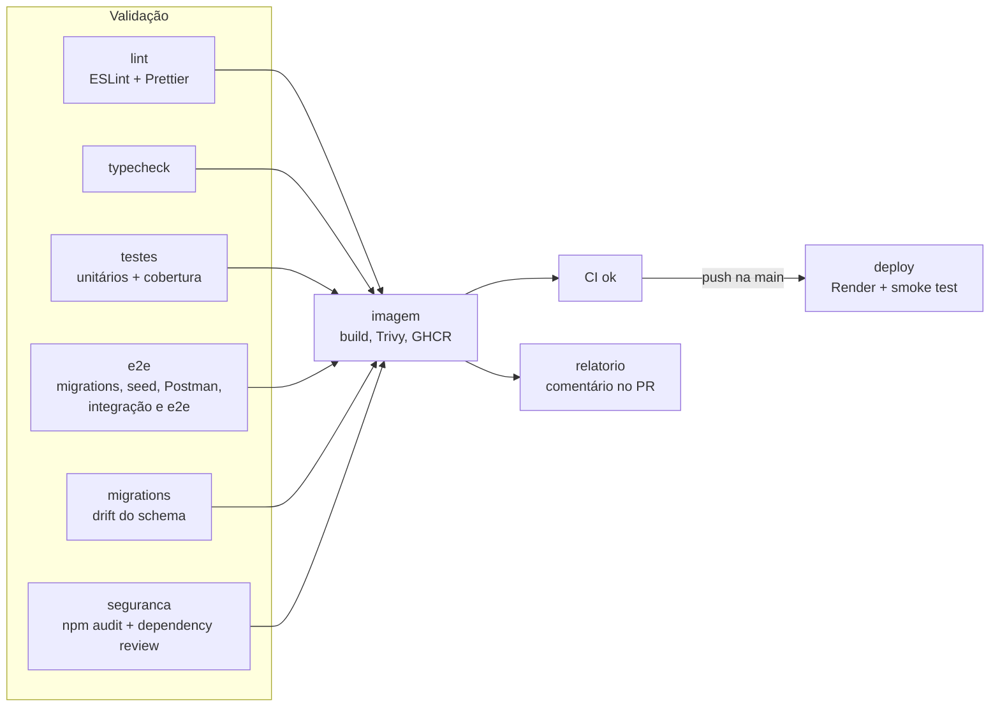
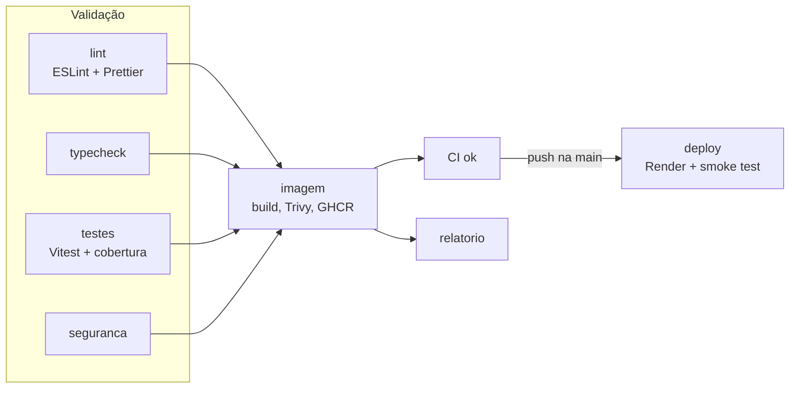

# Pipeline de CI/CD

Backend e frontend têm o mesmo desenho de pipeline no GitHub Actions
(`.github/workflows/ci.yml`):

- **PR para a `main`:** valida tudo e comenta o relatório no PR. Nada é
  publicado.
- **Push na `main`:** valida de novo, publica a imagem no GHCR, faz o deploy no
  Render e guarda a cobertura como referência para os próximos PRs.

Um push novo no mesmo PR cancela a execução anterior. Na `main` nada é
cancelado, para não interromper um deploy.

## Backend

| Job | O que confere | Falha quando |
|---|---|---|
| `lint` | `npm run lint:check` e `npm run format:check` | regra do ESLint ou arquivo fora do Prettier |
| `typecheck` | `tsc --noEmit` | erro de tipo |
| `testes` | Jest com cobertura | teste falha, alguma métrica de cobertura (statements, branches, funções ou linhas) fica abaixo de 100% ou a cobertura cai mais de 1 ponto em relação à `main` |
| `e2e` | sobe um Postgres 18 de serviço, aplica migrations, roda o seed, compila a API, roda a coleção do Postman e depois `test:integration` e `test:e2e` | migrations ou seed falham num banco limpo, ou algum teste de integração ou e2e falha; a coleção do Postman só entra no relatório |
| `migrations` | `prisma migrate diff` entre o schema e as migrations | `schema.prisma` mudou sem migration |
| `seguranca` | `npm audit --omit=dev --audit-level=high` e dependency review no PR | vulnerabilidade alta em dependência de produção, ou dependência nova com vulnerabilidade ou licença GPL/AGPL |
| `imagem` | build do `Dockerfile` e varredura com Trivy | vulnerabilidade `CRITICAL` corrigível na imagem |
| `ci-ok` | agrega os jobs acima | qualquer um deles falhou; é o único check exigido pelo ruleset |
| `relatorio` | junta os resultados e comenta no PR | não bloqueia |
| `deploy` | dispara o deploy hook do Render com a imagem `sha-<commit>` e espera `/health/db` responder `up` por até 10 minutos | a API não volta; o log orienta o rollback pelo Render |

O deploy usa a imagem exata do commit testado, não "a última". As migrations
rodam no `CMD` da imagem quando o container novo sobe.

## Frontend

Os jobs têm o mesmo papel que no backend. O frontend não tem banco, então não
tem `e2e` nem `migrations`. O smoke test do deploy confere se a página inicial
em `WEB_PUBLIC_URL` responde.

## Outros workflows

| Workflow | Quando roda | O que faz |
|---|---|---|
| `codeql.yml` | PR, push na `main` e toda segunda às 9h30 UTC | análise estática de segurança do JavaScript e TypeScript |
| `pr-titulo.yml` | abrir ou editar um PR | recusa título fora do padrão Conventional Commits |

## Documentação

Este site (repositório `docs`) é publicado no GitHub Pages pelo `deploy.yml` a
cada push na `main`: `npm ci`, `npm run build` e publicação do `build/`. O
build falha com link quebrado (`onBrokenLinks: 'throw'`), o que impede publicar
uma página que aponta para outra que não existe.

## Segredos e variáveis

| Nome | Tipo | Uso |
|---|---|---|
| `RENDER_DEPLOY_HOOK` | secret do environment `production` | URL do deploy hook do Render |
| `API_PUBLIC_URL` | variable do repositório (backend) | endereço do smoke test |
| `WEB_PUBLIC_URL` | variable do repositório (frontend) | endereço do smoke test |

O banco do job `e2e` é descartável e usa credenciais fixas de teste
(`ci`/`ci`), que não são segredo. Nenhum segredo de produção chega a um PR.
